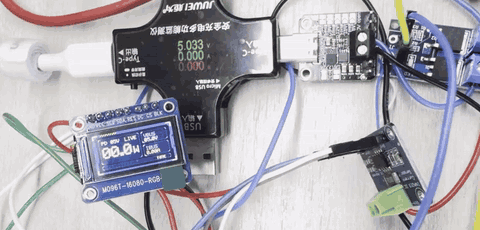
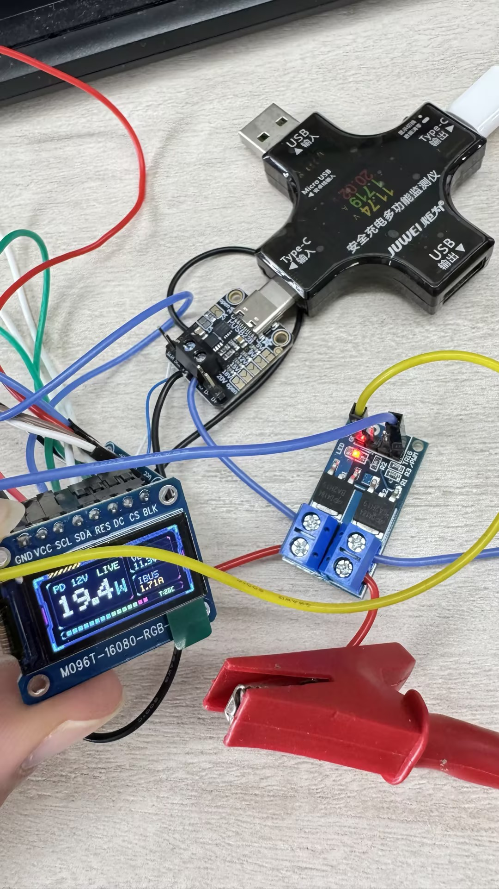
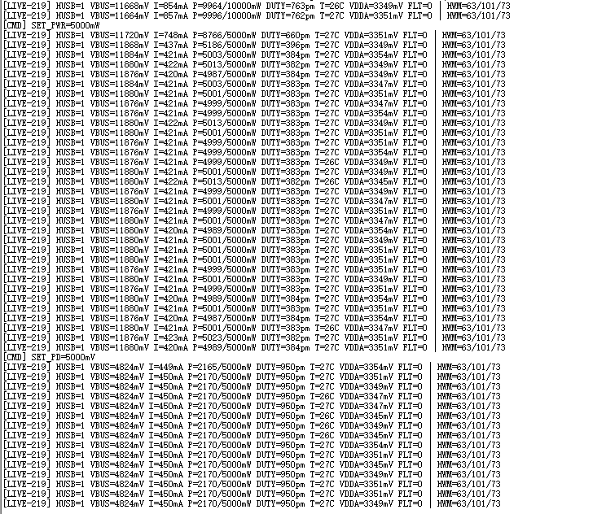
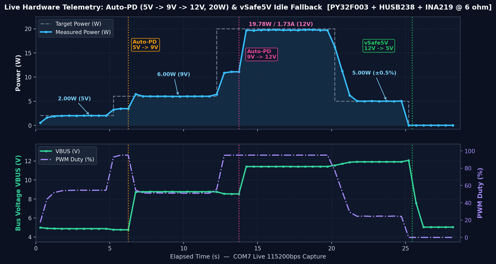
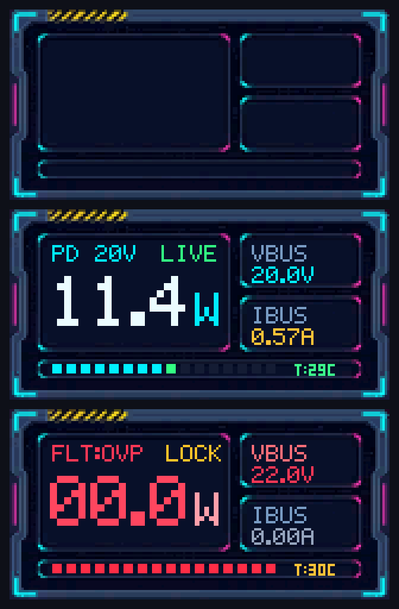

# pd_power_ctrl — USB-PD 闭环恒功率电子负载控制器

[-blue)]()
[-brightgreen)]()
[]()
[]()
[]()
[](LICENSE)

基于 **`PY32F003F18P6`（Cortex-M0+, `24MHz HSI`, `64KB Flash / 8KB SRAM`）** 与全静态 **FreeRTOS v11.2.0** 的数字闭环恒功率电子负载实验平台。

系统通过 `HUSB238` 请求 Type-C PD 电压档位，由 `INA219 / INA226` 采集母线电压与分流电流，经 `20ms` 定点 PI 控制环调节 `20kHz` 低侧 MOSFET 斩波占空比，并在 `0.96"` (`160×80`) `ST7735S` 彩屏上输出遥测数据与故障状态。

---

## 实机运行演示（`Auto-PD` 二级升压 + `vSafe5V` 停机回落）

> **测试序列（`2×` 速，串口仅下发目标功率指令）**：`5V (2W)` → 发 `P 6000` 饱和后自动请求 **`9V (6W)`** → 发 `P 20000` 自动请求 **`12V (20.3W)`** → 阶跃回落 **`5W`** → 发 `P 0` 停载 `500ms` 后自动退回 **`5V (vSafe5V)`**

<p align="center">
  
</p>

### 实测截图与波形

| 0.96" ST7735S 彩屏实拍（`6.25KB` BC1 软解） | `9V` PD 切压与功率计对照 | `12V 20.02W` 满载对照 |
| :---: | :---: | :---: |
|  |  |  |
| `1,280B` 单条带流式叠字 | 炬为表 `9.007V` vs 彩屏 `09.0V` | 炬为表 `1.719A / 20.02W` vs 彩屏 `1.71A / 19.4W` |

| `10W → 5W` 阶跃收敛日志（稳态 `4999~5001 mW`，`±0.02%`） | `OCP_S` 软件过流关断 + 双页 Flash 黑匣子异步落盘 |
| :---: | :---: |
|  |  |

**`Auto-PD` 二级升压（`5V → 9V → 12V, 20W`）与 `vSafe5V` 停机回落（`12V → 5V`）串口录数波形：**



### HUD 背景原图与 `BC1/DXT1` 4:1 软解叠字预览

| HUD 背景原图（`Tools/assets/cyber_mech_hud_src.jpg`） | `6.25KB` BC1 软解还原与 `LIVE / FLT` 叠字三态 |
| :---: | :---: |
|  |  |
| `160×80` 横屏布局底图 | `25.0KB → 6.25KB`（`PSNR 34.66 dB`），`1,280B` 单条带局部刷新 |

---

## 性能与资源占用

| 维度 | 实测结果 | 测试条件与说明 |
| :--- | :--- | :--- |
| **恒功率闭环稳态波动** | **`±1 mW` (`±0.02%`)** | `12V + 10Ω` 负载，`5W` 稳态 `4999~5001 mW`，`10W` 稳态 `9996 mW`（`0.04%`） |
| **满载带载能力** | **`20.02 W`**（`11.74V / 1.719A`） | `10Ω // 15Ω = 6Ω` 并联铝壳电阻，电流采样与外置功率计偏差 `~0.5%` |
| **Flash / SRAM 占用** | **`36.52 KB` / `5.87 KB`** | 可用 `63.75KB Flash / 7.97KB SRAM`（已扣除末两页 `256B` 黑匣子与顶段 `32B` `NOINIT` 区） |
| **任务栈分配与水位** | **静态深 `328 / 272 / 424 B`<br>(`v1.0.0` 实测 `HWM = 62 / 80 / 68w`)** | `CTRL(640B)` / `PD(640B)` / `LOG(768B)`：左侧为本版 Keil `CallGraph` 静态调用深度（不含指针与现场压栈）；右侧为 `v1.0.0` 满载实机剩余水位，加固后待复测 |
| **彩屏背景存储开销** | **`25.0 KB → 6.25 KB` (4:1)** | Cortex-M0+ 无除法 `BC1/DXT1` 软解（`PSNR 34.66 dB`），RAM 仅占 `1,280B` 条带缓冲 |
| **宿主机单测与编译** | **`26 / 26` 通过，Keil `0 Error / 0 Warning`** | PC 端 MinGW GCC (`-Wall -Wextra -Werror`) 跑通逻辑层与 Mock I2C/Flash 驱动测试 |

---

## 系统架构图


---

## 工程权衡与问题修复记录（Engineering Trade-offs & Fixes）

| 问题与约束 | 根因分析与设计取舍 | 处理结果 |
| :--- | :--- | :--- |
| **`20kHz PWM` 斩波与 `INA219` 采样拍频** | `10Ω` 低占空比斩波下，`INA219` 默认 `4x` 均值（`2.13ms`）与 PWM 周期非整数倍截断产生混叠，稳态功率出现 `±200mW` 波动。按 `20ms` 控制周期将 `INA219` 重配为 **`0x3D67`（分流 `16x` 硬件平均 `8.51ms` + 总压 `4x` `2.13ms` = `10.64ms < 20ms`）**。 | `5W` 稳态波动从 `±200mW` 降至 **`±1mW (±0.02%)`**，`9V` 满载 `I=805mA` 连续 20 帧无跳动。 |
| **运行中传感器掉线与上电默认零功率（Fail-Safe）** | 运行中 I2C 线松脱绝不切回仿真数据推 MOS：`prot_step_sensor()` 在曾经上线后一旦读失败，第 1 拍立即切断 PWM，连续 2 拍（`40ms`）失败即锁存 **`PROT_FAULT_SENSOR_LOSS`** 并写黑匣子 `EVT=SNS`（`[SIM]→[LIVE]` 切换时顺带复位 PID 积分防突跳）；未接传感器默认 `duty=0`（需显式置编译宏 `APP_ALLOW_SIM_PWM_OUTPUT=1` 才允许空板发波）；上电默认 **`5V / 0W`** 待机。 | 消除断线开环盲推及上电自启负载风险；`HardFault` / `NMI` / `configASSERT` 入口直接写 `TIM1->CCR3 = 0` 与关 `MOE`（无函数调用防坏栈锁死），拿锁超时亦直接清零。 |
| **`8KB SRAM` 下的 `160×80` 彩屏刷新** | `160×80` RGB565 全帧需 `25.6KB`（超芯片总 RAM 3 倍）。编写离线 PCA+LS 编码器 (`Tools/img2bc1.py`) 做 **`BC1/DXT1` 4:1 压缩**，M0+ 端用 **`(x*683)>>11`** 替代 `/3` 软除法并在调色板层预交换高低字节，仅开 **`1,280B (160×4)` 单条带缓冲**做脏矩形局部解码叠字，由 `DMA1_CH2 -> SPI1` 发送。 | 背景图 **`25.0KB → 6.25KB`**（`PSNR 34.66 dB`），彩屏子系统仅占 `1.25KB RAM`，低优刷新不阻塞 `20ms` 控制环。 |
| **快环关断与 Flash 黑匣子异步解耦** | `PY32F003` 页擦写耗时数毫秒且期间阻塞取指。`Task_Ctrl` 触发 `UVP / OVP / OCP / OTP / SNS` 时第 1 拍先清零 PWM 并通过 **`xTaskNotifyGive`** 唤醒最低优先级的 `Task_Log`，在 `Task_Log` 中关中断写末两页 `2×128B` 乒乓 Flash（`seq + IEEE CRC32`）。 | 关断响应保持单拍确定性；Flash 写入与回读校验在低优任务完成，掉电损坏自动回退旧页。 |
| **`INA219 / INA226` 兼容与 `EXTI4` 原子锁存** | 驱动沿用早期 `dev_ina226.*` 命名，启动探测 `0xFE == 0x5449` 自动识别芯片：`INA226` 下启用 `PA4 EXTI4` 下降沿硬件中断直接清零 `TIM1->CCR3` 并置 `s_alert_irq_latched`，`bsp_pwm_set_duty_permille()` 关中断原子检查该标志防止任务上下文写回 PWM，且仅允许用户发 `C` 清除；`INA219`（无 `ALE`）屏蔽 `EXTI4` 并配 `2.0A / 2.5A` 软件两级 `OCP`。 | 消除 `EXTI4` 与任务写 `CCR3` 的竞态覆盖窗口，也避免大电流伴随 I2C 抖动时误清硬件告警诊断。 |

---

## 已知局限与硬件边界（Known Limitations）

1. **PWM 斩波拓扑 vs 线性电子负载**：功率级采用双 `D4184` N-MOS 低侧 `20kHz` 硬开关斩波（非运放+线性 MOS 恒流源）。依靠 `INA219` `8.51ms` 硬件积分均值与充电头输出电容平滑平均功率，适用于阻性加热/负载测试，不能替代带 LC 输入滤波或线性功率级的精密源表。
2. **电流保护响应带宽**：实板装配的 `INA219` 无硬件 `ALERT` 引脚，过流保护依赖 `Task_Ctrl` 每 `20ms` 的 I2C 轮询（硬阈值 `2.5A` 1 拍 = `20ms`，软阈值 `2.0A` 2 拍 = `40ms`）；若需微秒级硬件过流切断，需换装带 `ALE` 引脚的 `INA226`（触发 `PA4 EXTI4` 中断直关 `TIM1`）或外加硬件比较器接 `TIM1_BKIN`。
3. **复位高阻态与散热边界**：MCU 处于复位或未初始化期间 GPIO 为高阻态，硬件连线时建议在 MOS 模块 `TRIG/PWM` 输入端并联 `10kΩ` 下拉电阻确保默认关断；双 `D4184` 模块无主动散热片，连续运行建议控制在 `20W` 以内。

---

## RTOS 任务调度与 SRAM 内存布局

> 全系统配置 `configSUPPORT_STATIC_ALLOCATION = 1` / `configSUPPORT_DYNAMIC_ALLOCATION = 0`（`Heap_Size = 0`），开启 `configCHECK_FOR_STACK_OVERFLOW = 2` 与 `HWM` 实时水位监控。

| 任务 | 优先级 | 周期 | 静态栈分配 | Keil 静态调用深度 / `v1.0.0` 实测剩余 (`HWM`) | 核心职责 |
| :--- | :---: | :---: | :---: | :---: | :--- |
| **`Task_Ctrl`** | `3` (最高) | `20 ms` | `160 words` (`640 B`) | 静态 `328 B` / **`248 B` (`62w`, v1.0.0 实测)** | `INA` 采压采流、定点恒功率 PI、软启动斜坡、OVP/OCP/OTP/断线关管 |
| **`Task_PD`** | `2` | `50 ms` | `160 words` (`640 B`) | 静态 `272 B` / **`320 B` (`80w`, v1.0.0 实测)** | `HUSB238` 6 档 PDO 择优协商、`Auto-PD` 饱和自动升挡、`vSafe5V` 停机/故障降压 |
| **`Task_Log`** | `1` (最低) | `50 ms` | `192 words` (`768 B`) | 静态 `424 B` / **`272 B` (`68w`, v1.0.0 实测)** | 串口 CLI、`200ms` 彩屏差分刷新、`ulTaskNotifyTake` 异步黑匣子写盘、三任务心跳汇总喂 `IWDG` |

**SRAM 内存布局 (`8,192 B / 8.00 KB`)：**
- **链接器保留顶段 `NOINIT` 遗言区**（`0x20001FE0..0x20001FFF`）：`32 B`（保存 `IWDG` 复位前电压/电流/占空比/存活任务掩码，热复位不清零）
- **应用可用 `RW_IRAM1`**（`8,160 B / 7.97 KB`）→ 实占 **`6,008 B (5.87 KB)`**，余量 **`2,152 B (2.10 KB)`**：
  - 3 业务任务静态栈 + Idle 任务栈（`96w`）：`2,432 B`
  - `TFT` `160×4` 单条带 DMA 缓冲 `s_strip_buf[640]`：`1,280 B`
  - Cortex-M0+ 中断主栈 `MSP`（`0x400`）：`1,024 B`
  - FreeRTOS 内核 + 3 TCB + 3 Mutex + 黑匣子状态 + ADC/UART 缓冲：`1,272 B`

---

## 硬件接线速查（PY32F003_Start Kit V1.1）

| 类别 | PY32F003 引脚 | 外设 / 复用 | 对接模块与说明 |
| :--- | :--- | :--- | :--- |
| **I2C 总线** | `PB6` / `PB7` | `I2C1` (AF6, 100kHz) | 并联 `HUSB238 (0x08)` + `INA219/INA226 (0x40)`（借板载 10k 上拉） |
| **PWM 功率输出** | `PA0` | `TIM1_CH3` (AF13, 20kHz) | 双 `D4184` MOS 模块 `TRIG/PWM`（复位期间 GPIO 为高阻态，**必须在外部 MOS 输入端并 `10kΩ` 下拉电阻**保证默认关断） |
| **串口调试** | `PA2` / `PA3` | `USART2` (AF4, 115200) | `CH340` (`3.3V` 档) `RXD / TXD` |
| **0.96" TFT 彩屏** | `PA5` / `PA7` | `SPI1_SCK / MOSI` (AF0, 12MHz) | 京东方 `ST7735S` `SCL / SDA`（`DMA1_CH2` 发送） |
| **TFT 控制脚** | `PA1` / `PA6` / `PA12` | 推挽输出 | `RES / DC / CS`；`VCC` 与 `BLK` 接 **`3.3V`（禁接 5V）** |
| **过流报警输入** | `PA4` | 上拉输入 + `EXTI4` 下降沿中断 | 接 `INA226 ALE`（中断内直接关断 `TIM1_CH3`）；装配 `INA219` 时悬空并由固件自动屏蔽 `EXTI4` |

> 完整功率主回路接线与注意事项请查阅 [01_硬件清单与完整接线图.md](doc/01_%E7%A1%AC%E4%BB%B6%E6%B8%85%E5%8D%95%E4%B8%8E%E5%AE%8C%E6%95%B4%E6%8E%A5%E7%BA%BF%E5%9B%BE.md)。

---

## 串口交互指令（`115200 8N1`，发送新行 `\r\n`）

| 指令 | 示例 | 功能 |
| :--- | :--- | :--- |
| `V <mV>` | `V 12000` | 设置目标 PD 电压（`5000 ~ 20000 mV`，不支持档位自动向下兼容） |
| `P <mW>` | `P 5000` | 设置恒功率目标（`0 ~ 20000 mW`，`P 0` 关闭输出） |
| `A` | `A` | 开关 `Auto-PD` 饱和自动升压挡（默认 **ON**） |
| `C` | `C` | 清除 `UVP / OVP / OCP / OTP / SNS` 故障锁存 |
| `L` / `E` | `L` / `E` | 导出 / 清空双页 Flash 故障黑匣子（最近 6 条现场快照） |
| `T` / `O` / `W` | `W` | 故障注入自检：`T` (`[SIM]` OVP)、`O` (`[SIM]` 90°C OTP)、`W` (IWDG 硬复位) |

---

## 仓库目录与构建命令

```text
pd_power_ctrl/
├── Logic_PureC/    # 零硬件依赖纯 C99 核心：PD 策略机/Auto-PD、定点 PID、保护状态机、双页黑匣子、BC1 软解
├── ExtDev/         # 依赖注入外设驱动：HUSB238、INA219/INA226 自动识别 (dev_ina226.*)
├── Firmware_PY32/  # PY32F003F18P6 Keil MDK 工程（静态 FreeRTOS + PY32 LL + ST7735S HUD + bg_cyber_mech.h）
├── Tests_Host/     # PC 宿主机 MinGW GCC 单元测试（26/26 全通过）
├── Tools/          # img2bc1.py 离线 BC1 压图编码器 + HUD 原图素材
└── doc/            # 硬件接线、架构说明与实测记录文档
```

```powershell
# 1. 运行 PC 宿主机全套单元测试（MinGW GCC -Werror，无需硬件）
powershell -ExecutionPolicy Bypass -File .\run_host_tests.ps1

# 2. 命令行全量编译 PY32F003 Keil 固件并输出 Flash/RAM 体积
powershell -ExecutionPolicy Bypass -File .\Firmware_PY32\build_keil.ps1 rebuild

# 3. 将自定义图片压成 6.25KB BC1 背景头文件并生成对比预览
python .\Tools\img2bc1.py .\Tools\assets\cyber_mech_hud_src.jpg --stretch --symbol g_bg_cyber_mech --out-c .\Firmware_PY32\Inc\bg_cyber_mech.h
```

---

## 详细技术文档与开源协议

- [01_硬件清单与完整接线图.md](doc/01_%E7%A1%AC%E4%BB%B6%E6%B8%85%E5%8D%95%E4%B8%8E%E5%AE%8C%E6%95%B4%E6%8E%A5%E7%BA%BF%E5%9B%BE.md) — 物料清单、功率/控制双回路拓扑与接线说明
- [02_软件架构与验证基线.md](doc/02_%E8%BD%AF%E4%BB%B6%E6%9E%B6%E6%9E%84%E4%B8%8E%E9%AA%8C%E8%AF%81%E5%9F%BA%E7%BA%BF.md) — 各阶段实测记录、串口日志截图与 `160×80` 叠字坐标规范
- 本项目采用 [MIT License](LICENSE) 开源（`Firmware_PY32/ThirdParty/` 下的 FreeRTOS 与 PY32 LL 驱动保留各自原开源许可）。
