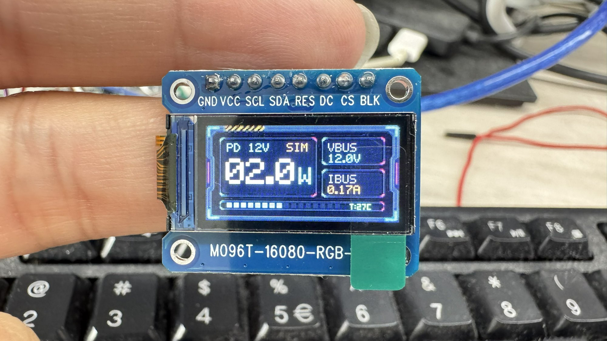
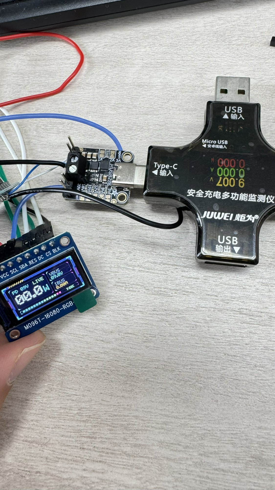
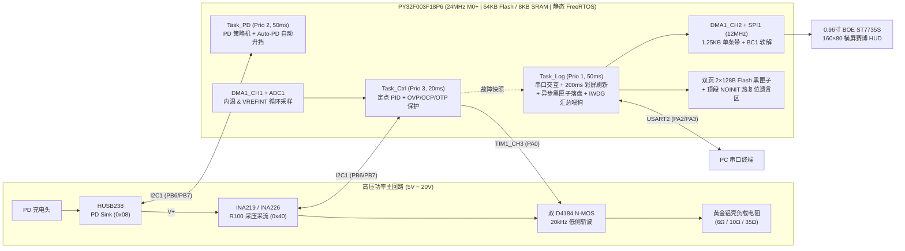

# pd_power_ctrl — USB-PD 闭环恒功率电子负载控制器

[-blue)]()
[-brightgreen)]()
[]()
[]()
[]()

> **这是什么？**  
> 一台基于入门级 **`PY32F003`（`64KB Flash / 8KB SRAM`）** 打造的**便携式 USB-PD 协议测试 & 恒功率电子负载仪**。  
> 插上任意 Type-C PD 充电头即可自动协商电压档位、按目标瓦数闭环恒功率带载（当前电压不够时可自动升档），并在 `0.96"` 赛博像素彩屏上实时显示功率、电压、电流、占空比与芯片温度，同时具备工业级多级保护与掉电黑匣子追溯。
>
> **实际用途 & 同源场景：**  
> - **研发测试工具**：验证 PD 充电头/充电宝真实 PDO 档位、满载烤机稳定性、Type-C 线缆压降与偶发保护抓拍；  
> - **量产产品原型**：与 PD 便携恒温电烙铁、迷你加热台、恒功率摄影补光灯、恒功率雾化/加热设备共享同一套「PD 协商 + 实时功率闭环 + 过温折返 + 故障黑匣子」核心控制架构。

---

## 真机实拍（全硬件闭环验收）

| 0.96" 赛博 HUD 彩屏特写（`6.25KB` BC1 软解） | `9V` PD 切压与炬为表同框校验 | `12V 20.02W` 满载同框实拍 |
| :---: | :---: | :---: |
|  |  |  |
| 首版一次点亮，零全屏显存透明叠字 | 炬为 `9.007V` vs 彩屏 `09.0V` | 炬为 `1.719A / 20.02W` vs 彩屏 `1.71A / 19.4W` |

---

## 核心实测指标一览

| 维度 | 实测结果 | 说明 |
| :--- | :--- | :--- |
| **恒功率闭环精度** | **`±1 mW` (`±0.02%`)** | `10Ω` 实板 `5W` 稳态 `4999~5001 mW`，`10W` 稳态 `9996 mW`（`0.04%`），阶跃零超调 |
| **满载实测能力** | **`20.02 W`**（`11.74V / 1.719A`） | `10Ω // 15Ω = 6Ω` 并联负载，电流与商业炬为表偏差仅 `~0.5%` |
| **Flash / SRAM 占用** | **`34.41 KB` / `5.87 KB`** | 仅 `63.75KB / 7.97KB` 可用空间下集成全静态 FreeRTOS + 双 DMA + 彩屏 + 黑匣子 |
| **三任务满载栈水位** | **`HWM = 63 / 101 / 73 words`** | `CTRL(160)` / `PD(160)` / `LOG(192)` 实测各剩 `252B / 404B / 292B`，零堆分配 |
| **彩屏背景压缩** | **`25.0 KB → 6.25 KB` (4:1)** | 自研 M0+ 无除法 `BC1/DXT1` 软解（`PSNR 34.66 dB`），仅用 `1,280B` 单条带缓冲 |
| **自动化验证门禁** | **`23 / 23` 通过，Keil `0 Error / 0 Warning`** | PC 宿主机 MinGW GCC (`-Werror`) + Mock I2C/Flash 全覆盖 |

---

## 系统架构图



---

## 5 大核心工程亮点

1. **极限资源下的全静态 RTOS + 双通道 DMA**：在 `8KB SRAM` 上零 `malloc` 运行 FreeRTOS 三任务；`DMA1_CH1` 零 CPU 开销持续采样内部温度与 `VREFINT`（实时校正 `VDDA` 并驱动 `70~85°C` 线性过温降功率），`DMA1_CH2` 异步推送 `12MHz SPI1` 彩屏像素，完全不阻塞 `20ms` 功率闭环。
2. **软硬解耦 + 真机采样拍频排错**：通过 `i2c_bus_ops_t` 实现 `INA219/INA226` 运行时自动识别（插 `INA219` 自动放开 `2.0A/2.5A` 过流线，插 `INA226` 启用 `750mA` + 硬件 `ALE` 瞬断）；实测定位 `10Ω` 低占空比 `20kHz PWM` 与 `4x` 采样的 `±200mW` 拍频抖动，升级 `INA219` 至 **`0x3D67`（分流 16x 硬件平均 `8.51ms`，总周期 `10.64ms < 20ms`）** 后，将稳态精度压至 **`±1mW (±0.02%)`**。
3. **`Auto-PD` 饱和逐级自动升压挡**：当前电压顶满占空比（`>=940pm`）且实测功率低于目标 `92%` 持续 `1.0s` 时，自动向充电器请求更高一档 PDO（`5V→9V→12V→15V→20V`）；内置 **`I>=20mA` 空载防误升**、`1.5s` 升档冷却、故障锁存屏蔽与最高档自动止步四道安全闸。
4. **协作看门狗 + 防掉电撕裂双页黑匣子**：三任务心跳位图汇总由最低优先级任务喂 `IWDG`；链接器隔离顶段 `0x20001FE0` `NOINIT` 遗言区与末两页 `0x0800FF00/FF80` Flash（单调 `seq + IEEE CRC32` 双页乒乓，正常开机零磨损），快环关管 + 低优先级异步擦写，真机实测 `UVP / OVP / OCP_S / OTP / IWDG` 全路径可追溯。
5. **8KB 内存无除法 `BC1` 4:1 彩屏子系统**：自研 Python PCA+最小二乘编码器 (`Tools/img2bc1.py`) 与 M0+ 无除法软解器（`(x*683)>>11` 替代 `/3`、调色板级大端交换直出 SPI DMA），仅用 `1,280B (160×4)` 单条带缓冲做 `O(1)` 局部背景解码 + 透明叠字刷新。

---

## 硬件接线速查（PY32F003_Start Kit V1.1）

| 类别 | PY32F003 引脚 | 外设 / 复用 | 对接模块与说明 |
| :--- | :--- | :--- | :--- |
| **I2C 总线** | `PB6` / `PB7` | `I2C1` (AF6, 100kHz) | 并联 `HUSB238 (0x08)` + `INA219/INA226 (0x40)`（借板载 10k 上拉） |
| **PWM 功率输出** | `PA0` | `TIM1_CH3` (AF13, 20kHz) | 双 `D4184` MOS 模块 `TRIG/PWM` |
| **串口调试** | `PA2` / `PA3` | `USART2` (AF4, 115200) | `CH340` (`3.3V` 档) `RXD / TXD` |
| **0.96" TFT 彩屏** | `PA5` / `PA7` | `SPI1_SCK / MOSI` (AF0, 12MHz) | 京东方 `ST7735S` `SCL / SDA`（`DMA1_CH2` 异步发送） |
| **TFT 控制脚** | `PA1` / `PA6` / `PA12` | 推挽输出 | `RES / DC / CS`；`VCC` 与 `BLK` 接 **`3.3V`（严禁 5V）** |
| **硬件报警** | `PA4` | 上拉输入 | 仅 `INA226` 时接 `ALE`；使用 `INA219` 时悬空即可 |

> ⚠️ 完整功率主回路接线与 5 条防炸红线请先阅读 [01_硬件清单与完整接线图.md](doc/01_%E7%A1%AC%E4%BB%B6%E6%B8%85%E5%8D%95%E4%B8%8E%E5%AE%8C%E6%95%B4%E6%8E%A5%E7%BA%BF%E5%9B%BE.md)。

---

## 串口交互指令（`115200 8N1`，发送新行 `\r\n`）

| 指令 | 示例 | 功能 |
| :--- | :--- | :--- |
| `V <mV>` | `V 12000` | 设置目标 PD 电压（`5000 ~ 20000 mV`，不支持档位自动向下兼容） |
| `P <mW>` | `P 5000` | 设置恒功率目标（`0 ~ 20000 mW`，`P 0` 关闭输出） |
| `A` | `A` | 开关 `Auto-PD` 饱和自动升压挡（默认 **ON**） |
| `C` | `C` | 清除 `UVP / OVP / OCP / OTP` 故障锁存 |
| `L` / `E` | `L` / `E` | 导出 / 清空双页 Flash 故障黑匣子（最近 6 条完整现场快照） |
| `T` / `O` / `W` | `W` | 故障注入自检：`T` (`[SIM]` OVP)、`O` (`[SIM]` 90°C OTP)、`W` (IWDG 硬复位) |

---

## 仓库目录与一键构建

```text
pd_power_ctrl/
├── Logic_PureC/    # 零硬件依赖纯 C99 核心：PD 策略机/Auto-PD、定点 PID、保护状态机、双页黑匣子、BC1 软解
├── ExtDev/         # 依赖注入外设驱动：HUSB238、INA219/INA226 自动识别
├── Firmware_PY32/  # PY32F003F18P6 Keil MDK 工程（静态 FreeRTOS + PY32 LL + ST7735S HUD + bg_cyber_mech.h）
├── Tests_Host/     # PC 宿主机 MinGW GCC 单元测试（23/23 全绿）
├── Tools/          # img2bc1.py 离线 BC1 压图编码器 + 赛博 HUD 原图素材
└── doc/            # 完整图文文档与真机实测证据图集
```

```powershell
# 1. 运行 PC 宿主机全套单元测试（MinGW GCC -Werror，无需硬件）
powershell -ExecutionPolicy Bypass -File .\run_host_tests.ps1

# 2. 命令行全量编译 PY32F003 Keil 固件并输出 Flash/RAM 体积
powershell -ExecutionPolicy Bypass -File .\Firmware_PY32\build_keil.ps1 rebuild

# 3. 将任意自定义图片压成 6.25KB BC1 背景头文件并生成对比预览
python .\Tools\img2bc1.py .\Tools\assets\cyber_mech_hud_src.jpg --stretch --symbol g_bg_cyber_mech --out-c .\Firmware_PY32\Inc\bg_cyber_mech.h
```

---

## 详细技术文档

- [01_硬件清单与完整接线图.md](doc/01_%E7%A1%AC%E4%BB%B6%E6%B8%85%E5%8D%95%E4%B8%8E%E5%AE%8C%E6%95%B4%E6%8E%A5%E7%BA%BF%E5%9B%BE.md) — 物料清单、功率/控制双回路拓扑与焊接防坑红线
- [02_软件架构与验证基线.md](doc/02_%E8%BD%AF%E4%BB%B6%E6%9E%B6%E6%9E%84%E4%B8%8E%E9%AA%8C%E8%AF%81%E5%9F%BA%E7%BA%BF.md) — 全套实测基线数据、串口证据截图与 `160×80` 叠字坐标规范
