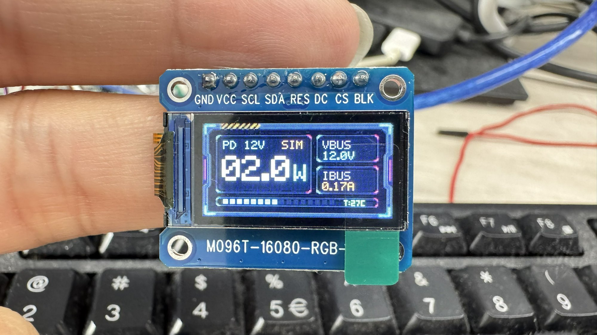
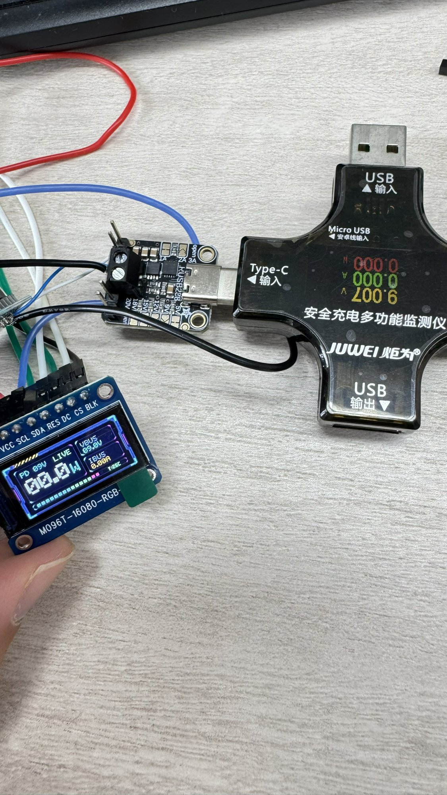
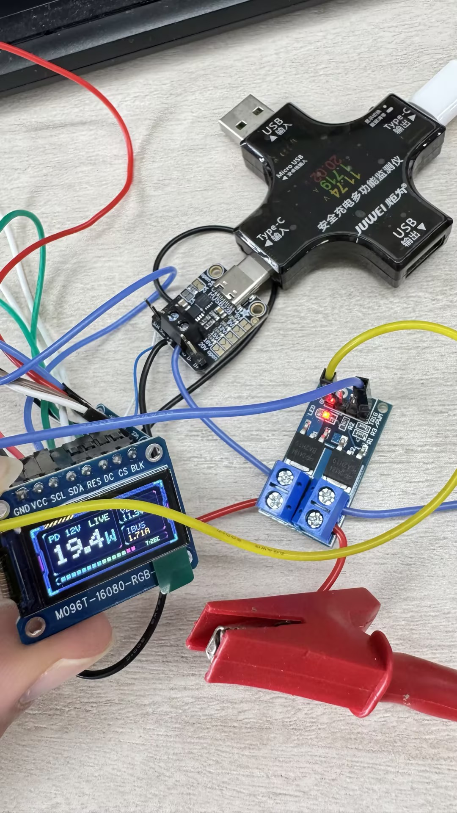
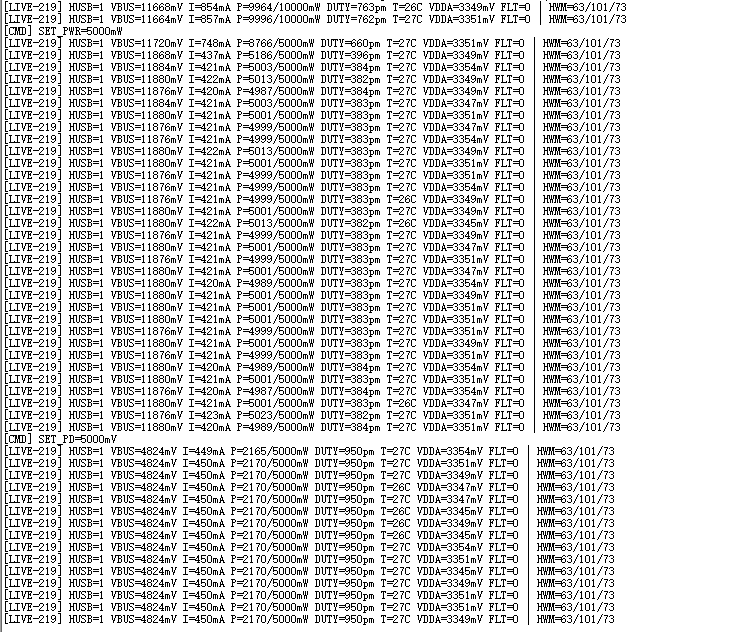
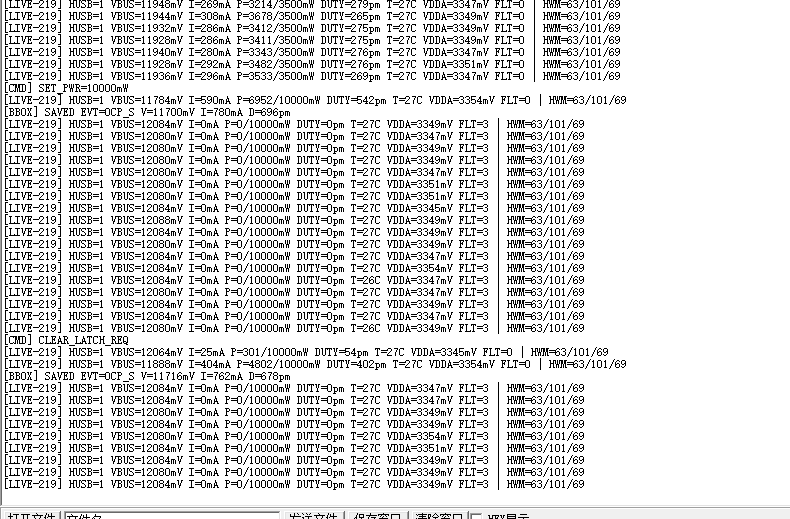

# 02. 软件架构与验证基线

## 1. 四层解耦架构

```text
E:\personal\pd_power_ctrl\
├── Logic_PureC/        # 纯标准 C99、零浮点、零动态内存、零硬件依赖
│   ├── pd_sink_policy.c/.h   # HUSB238 6 档 PDO 择优、稳态超时与通讯异常安全回退 5V
│   ├── power_pid.c/.h        # 定点整数恒功率 PID（软启动斜坡 + 饱和余量抗积分饱和）
│   ├── prot_ovp_ocp.c/.h     # UVP/OVP/软OCP/OTP 消抖锁存 + 过温线性降功率 + 硬件 ALE 瞬断
│   ├── fault_blackbox.c/.h   # 双页乒乓 128B Flash 故障黑匣子（IEEE CRC32 + 6 条环形记录）
│   └── bc1_decode.c/.h       # 无除法 BC1/DXT1 4×4 纹理软解器（4:1 压缩，支持任意非对齐局部叠字与 SPI 大端输出）
├── Tools/              # 离线工程辅助脚本与定稿素材
│   ├── img2bc1.py            # PNG/JPG/BMP -> 160×80 BC1 6.25KB C 头文件离线编码器（支持 --stretch / --dim 与 PSNR 预览）
│   └── assets/cyber_mech_hud_src.jpg  # 赛博像素风横屏 HUD 定稿原图素材
├── ExtDev/             # 外设芯片驱动层（通过 i2c_bus_ops_t 依赖注入，可跑 PC 单测）
│   ├── i2c_bus.h             # 硬件无关 I2C 寄存器读写抽象接口
│   ├── dev_husb238.c/.h      # HUSB238 (0x08) 探测、PDO 读取与 GO_COMMAND 切压
│   └── dev_ina226.c/.h       # INA226 (0x40, R100) 校准、定点 mV/mA/mW 与 ALE 超流配置
├── Firmware_PY32/      # PY32F003F18P6 Keil MDK 工程（LL 库 + 静态 FreeRTOS v11.2.0）
│   ├── Inc/FreeRTOSConfig.h  # 全静态分配 (NO heap)、栈溢出钩子、HWM 统计
│   ├── Inc/bg_cyber_mech.h   # 已编好定稿 160×80 BC1 背景头文件（6,400 B / 6.25 KB，PSNR 34.66 dB）
│   ├── Inc/Src/tft_hud.*     # BOE 0.96" ST7735S 驱动 + 1.25KB 单条带 DMA 缓冲 + 200ms 脏区透明叠字 UI
│   ├── Inc/Src/bsp_board.*   # 24MHz HSI、20kHz PWM、I2C1、USART2、ADC1+DMA1_CH1、SPI1(12MHz)+DMA1_CH2、IWDG、Flash 页写、NOINIT 遗言区
│   ├── Src/main.c            # 3 个静态任务 + 3 把互斥锁 + 协作任务看门狗 + 故障延迟落盘
│   └── build_keil.ps1        # Keil UV4 CLI 一键全量编译脚本
├── Tests_Host/         # PC 宿主机 MinGW GCC 单元测试（逻辑层 + Mock I2C 外设驱动）
└── run_host_tests.ps1  # -std=c99 -Wall -Wextra -Werror -O2 零警告跑通全套单测
```

---

## 2. 串口指令与 `[SIM]` / `[LIVE]` 双模机制

固件内置 `I2C1` 在线探测与故障自动切换：
* **串口不接外设时（`[SIM]` 模式）**：自动使用内置 `35Ω` 仿真负载与虚拟 PDO 表，正常驱动 `PA0` 真实输出 `20kHz PWM`，方便在快递到达前直接用示波器和串口验证 PID 与 RTOS。
* **插上 `HUSB238` / `INA226` 后（`[LIVE]` 模式）**：自动切为真实 `I2C` 读取 `INA226` 电压电流与 `HUSB238` 切压，无需重新烧录固件。

### 串口交互指令（`115200 8N1`，需勾选发送新行 `\r\n`，取消勾选 HEX 发送/显示）

| 指令 | 示例 | 作用 |
|---|---|---|
| `V <mV>` | `V 20000` | 设置目标 PD 电压（范围 `5000 ~ 20000 mV`） |
| `P <mW>` | `P 3000` | 设置闭环目标功率（范围 `0 ~ 20000 mW`，`P 0` 立即关闭输出） |
| `A` | `A` | 开关“饱和自动升压挡 (`AUTO_PD`)”（默认 **ON**：占空比顶满且带载欠功率持续 1s 时自动升一档更高 PDO） |
| `C` | `C` | 清除 `OVP / OCP / ALE` 锁存故障（需已回落至安全迟滞区） |
| `L` | `L` | 导出 Flash 故障黑匣子摘要与最近 `6` 条故障/看门狗复位现场快照 |
| `E` | `E` | 清空双页 Flash 故障黑匣子历史记录与计数 |
| `T` | `T` | 仅 `[SIM]` 模式有效：注入 4 拍 `22000mV` 过压，测试 OVP 关管与黑匣子落盘 |
| `O` | `O` | 仅 `[SIM]` 模式有效：注入 4 拍 `90°C` 过温，测试 OTP 关管与黑匣子 `EVT=OTP` 落盘 |
| `W` | `W` | 停止 `Task_Log` 喂狗上报，实测 `IWDG` (~2s) 硬件复位与 NOINIT 遗言落盘 |
| `H` | `H` | 打印指令帮助 |

---

## 3. 已验证基线数据（2026-11-18 ~ 2026-11-23 实测记录）

### A. PC 宿主机单元测试（`run_host_tests.ps1`）
* 编译器：`C:\mingw64\bin\gcc.exe` (`-std=c99 -Wall -Wextra -Werror -O2`)
* 结果：**`Total: 23, Passed: 23, Failed: 0`**（覆盖 PD 择优/异常回退/**饱和自动升挡与空载防误升**、PID 电压跃变稳态跟踪与抗饱和、OVP/OCP 消抖迟滞锁存、过温线性折返与 OTP 迟滞恢复、HUSB238 / INA226 / **INA219 自动识别与 `0x3D67` 16 次平均转换** Mock I2C 测试、双页乒乓黑匣子掉电损坏恢复/环形覆写/双向擦除，以及 BC1/DXT1 4色/3色块解码、SPI 大端字节序交换与任意非对齐脏矩形解码一致性）。

### B. Keil ARMCC V5.06 编译结果（`Firmware_PY32\build_keil.ps1 rebuild`）
* 结果：**`0 Error(s), 0 Warning(s)`**，已生成 `.hex` 与 `.axf`；`LR_IROM1 = 0xFF00`（末 `256B` 页 `0x0800FF00..0x0800FFFF` 专供双页黑匣子）、`RW_IRAM1 = 0x1FE0`（末 `32B` `0x20001FE0..0x20001FFF` 专供热复位 NOINIT 遗言区）。
* **`PY32F003F18P6`（`64KB Flash / 8KB SRAM`）最新整包资源占用**（全功能合入自动升挡 PD、`INA219/INA226` 自动识别、`SPI1+DMA1_CH2`、`ST7735S` 驱动、`BC1` 解码器、`6.25KB` 赛博背景与点阵字库）：
  * **Flash**：`35,240 B`（**`34.41 KB` / `63.75 KB`**，剩余 **`29.34 KB`**）
  * **RAM**：`6,008 B`（**`5.87 KB` / `7.97 KB`**，含 `1,280 B` TFT 单条带 DMA 缓冲、`1KB` 主栈、FreeRTOS 内核、3 任务栈及黑匣子缓存，剩余 **`2.10 KB`**）

### C. 上板实测串口与示波器基线（`[SIM]` 模式，`COM7 115200`）
* **示波器实测 `PA0`**：`20kHz` PWM 输出正常，占空比随串口功率/电压指令实时联动。
* **串口实测 `P 3500` → `P 3000` 闭环收敛过程**（初版基线）：
  * `3501mW (DUTY=851pm)` → `3266mW (794pm)` → `3064mW (745pm)` → `3015mW (733pm)` → 稳态 **`2999~3003mW (729~730pm)`**，零超调、稳态误差 `±1mW`。
* **初版任务栈水位参考（`HWM=66/100/100`）**：当前已将 `Task_Ctrl` 由 `144` 扩容至 `160` words、`Task_Log` 由 `144` 扩容至 `192` words，为 Flash 页编程局部变量留足安全余量。

### D. 新增实测基线：协作看门狗 + 双页 Flash 故障黑匣子（2026-11-18 真机实测）
* **`20V` 低功率闭环**：发 `V 20000` / `P 1000` 后实测稳态 `I=49~50mA`、`P=994~1005mW`、`DUTY=87~88pm`。
* **过压注入 (`T`) + 异步黑匣子落盘**：
  * 发 `T` 注入 4 拍 `22000mV` 后立刻打印 `[BBOX] SAVED EVT=OVP V=22000mV I=49mA D=79pm`，紧接着 `PA0` 占空比锁存为 `DUTY=0pm / FLT=2`；
  * 发 `L` 读出 `SEQ=7 SLOT=0 BOOT=0 IWDG_RST=0 TOTAL=1 VALID=1 LAST_RST=UNK`，记录 `#0 T=175700ms EVT=OVP V=22000mV I=49mA P=1092mW D=79pm FLG=8 EXT=2`，确认清锁 (`C`) 前保持锁存、`E` 清空后 `seq` 保持单调递增。
* **真机硬件 `IWDG` 复位 (`W`) + `NOINIT` 遗言区还原**：
  * 发 `W` 停掉 `Task_Log` 心跳后约 `2.0s`（4 条 `500ms` 心跳后）触发硬复位，重启首行识别 `[BOOT] PY32F003 PD+INA226+RTOS Ready RST=IWDG BBOX=3/3`；
  * 发 `L` 读出 `SEQ=3 SLOT=0 BOOT=3 IWDG_RST=3 TOTAL=3 VALID=3 LAST_RST=IWDG`，3 条记录均准确携带 `EXT=3`（`0b011` 标识 `CTRL`/`PD` 存活、`LOG` 失联）及复位前最后一刻现场（如 `V=12000mV D=487pm`、`V=20000mV D=307pm`）。
* **全场景压测后栈水位（`HWM=79/109/101` words）**：
  * `Task_Ctrl` (`160` words)：剩 `79 words (316B)`
  * `Task_PD` (`160` words)：剩 `109 words (436B)`
  * `Task_Log` (`192` words，含 `128B` 页写入缓冲栈帧)：剩 `101 words (404B)`

### E. 新增实测基线：ADC1+DMA1 温采 / 12V→20V 阶跃 / 环形覆盖 / OTP（2026-11-18 真机实测）
* **`ADC1 + DMA1` 内部采样实时遥测**：串口稳定输出芯片温度 **`T=28~30°C`** 与实时校准供电电压 **`VDDA=3351~3361mV`**（`3.358V` 典型 LDO 电压，跳动约 `±5mV`）。
* **`12V → 20V` 恒功率阶跃抗扰实测**：在 `P=2000mW` 稳态下发 `SET_PD=20000mV`，PID 在第一帧即把占空比从 **`486pm` 压至 `188pm`**，经 **`176pm`** 后第 3 帧稳态定格在 **`P=1999/2000mW (I=99mA, DUTY=175pm)`**，无震荡超调。
* **黑匣子满 6 条环形覆盖 + `OTP` 过温保护实测**：
  * 发 `O` 注入 4 拍 `90°C` 后触发 `FLT=5` (`PROT_FAULT_OTP`) 与 `DUTY=0pm` 锁存，已锁存状态下重复发 `O` 不重复擦写 Flash；
  * 发 `L` 读出 **`SEQ=17 SLOT=0 BOOT=4 IWDG_RST=4 TOTAL=11 VALID=6 LAST_RST=IWDG`**，最新记录 **`#0 T=79400ms EVT=OTP V=20000mV I=0mA P=0mW D=0pm FLG=8 EXT=5`**（先经 `>=85°C` 软折返降功至 `0` 再在第 3 拍硬锁存），`#1~#5` 完整保留最近 6 条 `IWDG` 与 `OVP` 历史事件，验证第 `11` 次故障对 `6` 槽位环形队列的正常覆盖与乒乓切换；
  * 最终全功能压测并导出黑匣子后栈高水位稳定在 **`HWM=70/100/94` words**（`Task_Ctrl=280B` / `Task_PD=400B` / `Task_Log=376B` 剩余）。

### F. 全硬件真机联调实测基线（2026-11-23 真板实测：`[LIVE-219]` + `HUSB238` + 双 MOS + `0.96"` 彩屏）
* **`0.96"` BOE `ST7735S` 彩屏首版一次点亮**：`160×80` 横屏 `BC1 (6.25KB)` 赛博机甲背景与实时叠字一次精准对齐（零白边、零裁剪、零色偏）；实拍与炬为功率表同框校验，`9.007V` 时彩屏同步显示 **`PD 09V / LIVE / VBUS 09.0V / IBUS 0.00A / T:26C`**。
* **双 I2C 实机在线与 PD 策略择优验证**：`HUSB238 (0x08)` 与 `INA219 (0x40)` 并联共用 `PB6/PB7` 稳定输出 **`[LIVE-219] HUSB=1`**；`5V / 9V / 12V` 串口切压与炬为表完全一致；在最高 `12V` 的 20W PD 充电头上发 `SET_PD=20000mV`，策略机自动向下兼容稳在最高可用 `12V (11864mV)`，无掉电复位。
* **真机过流保护 (`OCP_S`) + 黑匣子实板落盘验证**（单颗 `10Ω`、初版 `750mA` 阈值下）：
  * 发 `SET_PWR=10000mW` 后经软启动爬坡至 `I=590mA (6952mW)` → 越过 `750mA` 红线瞬间在 **`I=780mA, V=11700mV, D=696pm`** 切断输出并打印 **`[BBOX] SAVED EVT=OCP_S`**、锁存 `DUTY=0pm / FLT=3`（彩屏切红 `FLT:OCP LOCK`）；
  * 发 `C` 清锁后重新经软启动从 `25mA (54pm)` → `404mA (402pm)` 爬坡，于 **`I=762mA, V=11716mV, D=678pm`** 再次精准保护落盘。
* **`INA219` `16` 次分流硬件平均 (`0x3D67`) + `2.0A/2.5A` 自适应 `OCP` 后闭环实测**（单颗 `10Ω` 黄金电阻）：
  * **`10W` 稳态**：`VBUS=11664mV, I=857mA, DUTY=762pm`，实测 **`P = 9996 / 10000 mW`**（误差 **`0.04%`**）；
  * **`10W → 5W` 动态阶跃收敛**：`8766mW (660pm)` → `5186mW (396pm)` → `5003mW (384pm)` → 连续 20 帧死锁 **`4999 ~ 5001 / 5000 mW` (`I=421mA, DUTY=383pm`)**，零超调、真机稳态误差 **`±1 mW (±0.02%)`**；
  * **三档物理上限与滤波实测（`DUTY=950pm`）**：`12V` 达 **`12403~12424mW (I=1073~1074mA)`**、`9V` 达 **`6968~6971mW (I=805mA 连续 20 帧零跳动)`**、`5V` 达 **`2170mW (V=4824mV, I=450mA)`**；
  * **`20W` 满载实板验收（`10Ω // 15Ω = 6.0Ω` 并联负载 + `12V 20W` PD 充电头同框实拍）**：前端炬为功率表实测 **`11.74V / 1.719A / 20.02W`**，自研彩屏实测 **`PD 12V / LIVE / 11.3V / 1.71A / 19.4W / T:26C`**（电流与商业仪表偏差仅 **`~0.5% (9mA)`**，压差 `0.44V` 为 Type-C/HUSB238 开关管与导线压降，两端功率守恒 `19.4W + 0.6W ≈ 20.0W`，底部青→绿→洋红占空比条满格亮起）；
  * **全硬件满载并发栈水位**：稳定在 **`HWM = 63 / 101 / 73` words**（`Task_Ctrl=252B` / `Task_PD=404B` / `Task_Log=292B` 剩余）。

#### 实机验收图集（2026-11-23）

| 1. 0.96" 彩屏 BC1 (6.25KB) 首亮近景 | 2. 9V PD 切压与炬为表同框校验 | 3. 20.02W 满载闭环同框实拍 |
| :---: | :---: | :---: |
|  |  |  |

* **10W → 5W 阶跃 `±1mW (±0.02%)` 稳态串口证据**：

  

* **真机 `OCP_S` 软件过流保护 + 双页 Flash 黑匣子异步落盘证据**：

  

---

## 4. 后续迭代规划（Roadmap）

1. **✅ 已落地（`DMA1_CH1` + `ADC1` 循环采样 & 过温降功率 `OTP`）**
   * `DMA1_Channel1` 循环模式零 CPU 开销持续搬运 `4 帧 × [CH11 内部温度, CH12 VREFINT]`（`3MHz` ADC 时钟 / `239.5` 周期采样），实时反算 `VDDA` 与芯片温度；`70°C~85°C` 线性折返降功率、`>=85°C` 锁存 `OTP` 并落盘黑匣子。
2. **✅ 已真机验收（阶段 A：全硬件闭环联调 + `INA219/INA226` 自动识别 + `Auto-PD` 饱和自动升挡）**
   * `HUSB238` + `INA219 (R100, 0x3D67 16x 滤波)` + 双 `D4184` MOS + `35Ω / 10Ω / 6Ω` 黄金电阻全部真机跑通，实测 `5W` 稳态 `±1mW (±0.02%)`、`20.02W` 满载及 `OCP_S` 实板黑匣子落盘；
   * 新增 **`Auto-PD` 饱和自动升压挡**（`pd_auto_boost_t`，默认 `ON`，`A` 键可切换）：当真实带载 (`I >= 20mA`) 且无故障锁存时，若占空比 `>= 940pm` 且实测功率 `< 92%` 目标持续 `1.0s`，自动沿充电器广播 PDO 逐级升一档（`5V→9V→12V→15V→20V`），升档后强制 `1.5s` 冷却防震荡，升至最高档自动止步，空载绝不误升压。
3. **✅ 已真机点亮（阶段 B：0.96" BOE `ST7735S` `SPI1 + DMA1_CH2` + `BC1` 赛博 HUD）**
   * 已按商家原厂资料（`doc/0.96寸TFT -1`：BOE `UN096T-16080-RGB-8` `ST7735S`，横屏 `MADCTL=0x78`、`X_OFF=0 / Y_OFF=24`、`0x20` 正色）真机一次点亮，仅用 `1,280 B` (`160×4`) 单条带缓冲实现 `200ms` 差分脏区透明叠字刷新。
   * **定稿 `160×80` 局部叠字坐标规范**（预览见 [cyber_mech_live_sim.png](assets/cyber_mech_live_sim.png)）：
     * 左主槽顶栏 (`x=18, y=15`)：状态标签 `PD 20V` / `FLT:OVP` + `LIVE` / `SIM` / `LOCK`（`5×7`）
     * 左主槽大字 (`x=17, y=28`)：实时功率 `11.4`（`3×` 放大、`gap=2px`）+ 右侧单位 `W`（`2×` 放大、`y=35`，留 `4px` 间距）
     * 右上槽 (`x=102, y=15 / 24`)：`VBUS` + `20.0V`（`5×7`）
     * 右中槽 (`x=102, y=41 / 50`)：`IBUS` + `0.57A`（`5×7`）
     * 底部通栏 (`x=18, y=65`)：`96×4px` 分段彩色占空比条（正常青→绿→洋红渐变，故障全红）+ 右侧 `T:29C`（`3×5` 微字，`x=120, y=65`）
   * 复现压图命令：`python Tools\img2bc1.py Tools\assets\cyber_mech_hud_src.jpg --stretch --symbol g_bg_cyber_mech --out-c Firmware_PY32\Inc\bg_cyber_mech.h`
4. **阶段 C（可选扩展）：`DMA1_CH3` + `USART2 RX` 环形接收 / `20V` 充电头 `20W` 满载拓展**
   * 可选启用 `DMA1_Channel3` 替代串口单字节 RX 中断；换接支持 `20V` PDO 的充电头（或 `12V` 下用 `10Ω // 15Ω = 6Ω` 并联负载）可直接测试 `18~20W` 高功率档位。
